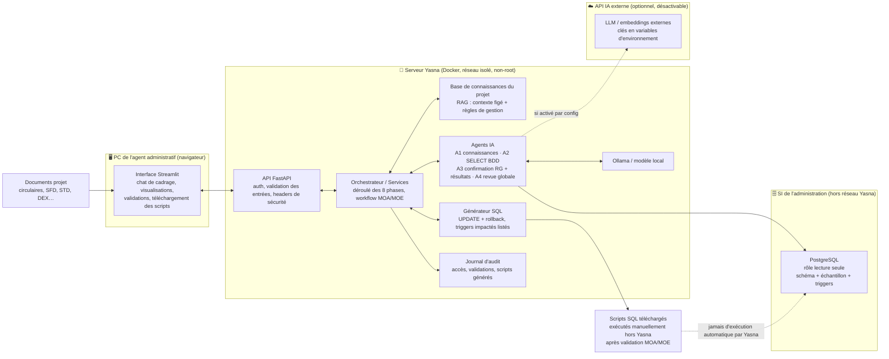
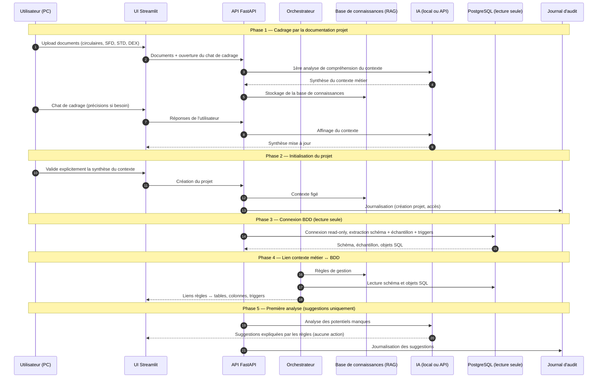
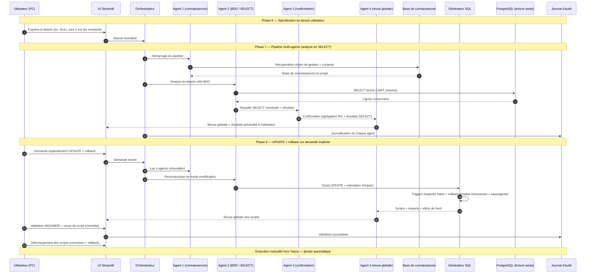
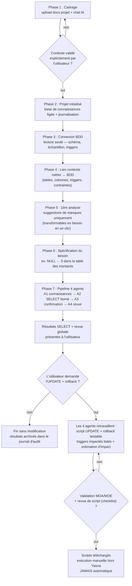

# Schémas du parcours Yasna

**Version 1.0 – Novembre 2026** — schémas du parcours en 8 phases décrit dans `Yasna_Document_Projet_v1.2.md` (section 3).

**Légende des lieux :**
- 🖥️ **PC utilisateur** : navigateur de l'agent administratif (MOA/MOE)
- 🐳 **Serveur Yasna** : conteneurs Docker (réseau isolé, non-root, capabilities droppées)
- 🧠 **IA** : locale par défaut (Ollama, dans le réseau Docker) ou API externe (configurable, désactivable)
- 🗄️ **BDD de l'administration** : PostgreSQL du SI, accessible **uniquement en lecture seule** (hors réseau Yasna)

---

## 1. Vue d'ensemble — acteurs, composants et lieux

---

## 2. Diagramme de séquence — phases 1 à 5 (cadrage → première analyse)

---

## 3. Diagramme de séquence — phases 6 à 8 (besoin → agents → scripts validés)

---

## 4. Flowchart du parcours — phases et points de décision

---

## 5. Tableau récapitulatif — qui fait quoi, où, avec quelles données

| Acteur | Rôle dans le parcours | Lieu | Données manipulées |
|--------|----------------------|------|-------------------|
| **Utilisateur** (agent administratif, MOA/MOE) | Upload des documents, chat de cadrage, validation du contexte, expression du besoin, validation MOA/MOE + revue de script, téléchargement des scripts | 🖥️ PC (navigateur) | Documents projet, besoins, validations |
| **UI Streamlit** | Chat, visualisations (suggestions, résultats, scripts), formulaires de validation | 🐳 Serveur Yasna (conteneur UI) | Données d'affichage uniquement |
| **API FastAPI** | Point d'entrée unique, auth, validation stricte des entrées, headers de sécurité, orchestration | 🐳 Serveur Yasna | Requêtes, métadonnées |
| **Orchestrateur / Services** | Déroulé des 8 phases, workflow MOA/MOE, appels IA, journalisation | 🐳 Serveur Yasna | États du projet |
| **Base de connaissances (RAG)** | Contexte métier figé + règles de gestion, interrogée par les agents | 🐳 Serveur Yasna | Documents projet vectorisés (non personnels) |
| **Agent 1** | Récupère la base de connaissances du projet | 🐳 Serveur Yasna | Règles de gestion + contexte |
| **Agent 2** | Lit la BDD (SELECT bornés), trouve les lignes, construit le SELECT puis l'UPDATE | 🐳 Serveur Yasna → 🗄️ BDD | Schéma, échantillon, lignes concernées |
| **Agent 3** | Agrège règles de gestion + résultats SELECT pour confirmation | 🐳 Serveur Yasna | Résultats intermédiaires |
| **Agent 4** | Revue globale, communication des résultats/scripts à l'utilisateur | 🐳 Serveur Yasna | Rapport de revue |
| **IA (LLM)** | Compréhension du contexte, chat, génération, revue | 🧠 Local (Ollama) par défaut, ou ☁️ API externe désactivable | Prompts/réponses (aucune donnée personnelle) |
| **Générateur SQL** | Scripts UPDATE + rollback, triggers impactés, estimation d'impact | 🐳 Serveur Yasna | Scripts (jamais exécutés par Yasna) |
| **PostgreSQL (SI de l'administration)** | Source des données | 🗄️ Hors réseau Yasna | Accès **lecture seule** (rôle à privilèges minimaux) |
| **Journal d'audit** | Traçabilité CNIL/ANSSI : accès, validations, scripts générés | 🐳 Serveur Yasna | Logs d'audit (sans données sensibles en clair) |

---

## 6. Points de sécurité visibles sur les schémas

- La BDD n'est jamais modifiée par Yasna : connexion **lecture seule** (rôle PostgreSQL dédié), SELECT **bornés** (LIMIT/timeout), et les scripts UPDATE/rollback sont **téléchargés puis exécutés manuellement hors Yasna**, après validation MOA/MOE.
- L'**API IA externe est optionnelle et désactivable** (pointillés sur le schéma 1) : mode local (Ollama) par défaut, clés jamais en dur (variables d'environnement).
- Le **chat de cadrage** n'accepte que des documents projet non personnels (circulaires, SFD, STD, DEX…) : aucune donnée de bénéficiaires.
- Toute action est **journalisée** (journal d'audit) : accès, validations, scripts générés — sans données sensibles en clair dans les logs.
- Conteneurs **non-root, capabilities droppées, réseau isolé** ; scripts générés avec **triggers impactés listés** et **rollback testable** (transaction + sauvegarde préalable).

---

*Fin des schémas – Version 1.0*
