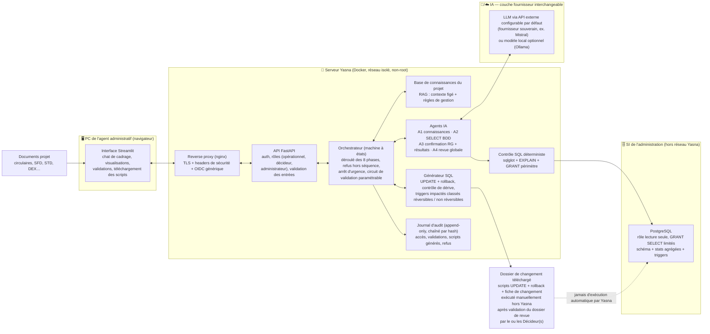
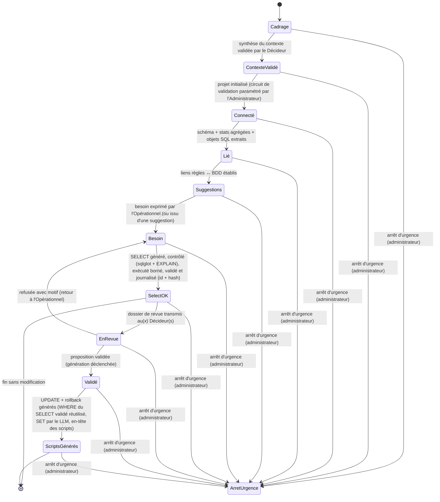
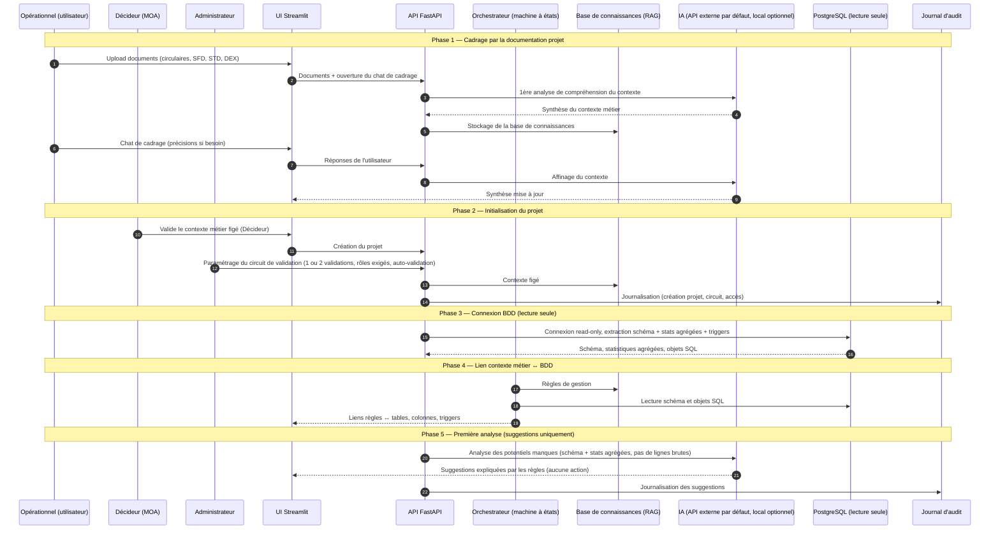
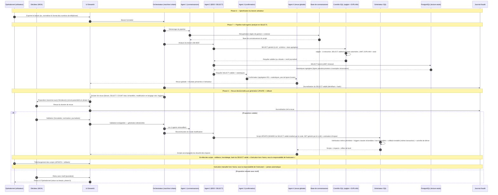
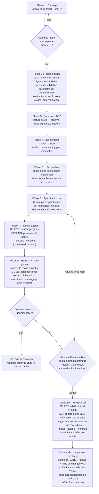

# Schémas du parcours Yasna

**Version 1.1 – Novembre 2026** — schémas du parcours en 8 phases décrit dans `Yasna_Document_Projet_v1.3.md` (section 3).

**Légende des lieux :**
- 🖥️ **PC utilisateur** : navigateur de l'utilisateur (rôles **opérationnel / décideur / administrateur**)
- 🐳 **Serveur Yasna** : conteneurs Docker (réseau isolé, non-root, capabilities droppées) derrière un **reverse proxy** (TLS, headers de sécurité)
- 🧠 **IA** : **API externe configurable par défaut** (fournisseur souverain, couche fournisseur interchangeable, variables d'environnement) ; **mode local optionnel** (Ollama)
- 🗄️ **BDD de l'administration** : PostgreSQL du SI, accessible **uniquement en lecture seule** (hors réseau Yasna)

---

## 1. Vue d'ensemble — acteurs, composants et lieux

---

## 2. Machine à états de l'orchestrateur

L'ordre des phases est imposé par le **code** (machine à états), pas par le prompt : chaque phase a un état d'entrée requis et l'API refuse toute action hors séquence. La revue exige un SELECT **validé et journalisé**, référencé par son **identifiant** et son **hash**, portant sur **exactement le même périmètre** ; la génération de l'UPDATE n'est déclenchée que par une **proposition validée** par le circuit décisionnel.

---

## 3. Diagramme de séquence — phases 1 à 5 (cadrage → première analyse)

---

## 4. Diagramme de séquence — phases 6 à 8 (besoin → agents → revue décisionnelle → scripts générés)

---

## 5. Flowchart du parcours — phases et points de décision

---

## 6. Tableau récapitulatif — qui fait quoi, où, avec quelles données

| Acteur | Rôle dans le parcours | Lieu | Données manipulées |
|--------|----------------------|------|-------------------|
| **Opérationnel** (utilisateur, ex. chargé de qualité des données, MOE applicative, analyste de données) | Upload des documents, chat de cadrage, expression du besoin, lancement de l'analyse (phases 1 à 7) ; ne peut pas générer d'UPDATE | 🖥️ PC (navigateur) | Documents projet, besoins, résultats d'analyse |
| **Décideur** (MOA propriétaire des données ; éventuellement un responsable technique selon l'organisation) | Valide le contexte métier figé (phase 2), revoit les propositions (dossier de revue), les valide ou les refuse avec motif, déclenche la génération de l'UPDATE | 🖥️ PC (navigateur) | Dossier de revue, validations (défaut : 1 validation, auto-validation interdite) |
| **Administrateur** (équipe technique / exploitation) | Comptes et rôles, connexion BDD, paramétrage du circuit de validation, arrêt d'urgence ; MFA obligatoire ; pas d'usage quotidien | 🖥️ PC (navigateur) | Paramètres du circuit, actions d'administration |
| **Reverse proxy** | TLS, headers de sécurité (CSP…), authentification **OIDC générique** devant l'UI et l'API | 🐳 Serveur Yasna | Requêtes HTTP |
| **UI Streamlit** | Chat, visualisations (suggestions, résultats, scripts), formulaires de validation | 🐳 Serveur Yasna (conteneur UI) | Données d'affichage uniquement |
| **API FastAPI** | Point d'entrée unique, auth + rôles (opérationnel, décideur, administrateur), validation stricte des entrées, refus des actions hors séquence | 🐳 Serveur Yasna | Requêtes, métadonnées |
| **Orchestrateur (machine à états)** | Déroulé des 8 phases imposé par le code, circuit de validation paramétrable, arrêt d'urgence, journalisation | 🐳 Serveur Yasna | États du projet, identifiant + hash du SELECT validé |
| **Base de connaissances (RAG)** | Contexte métier figé + règles de gestion, interrogée par les agents | 🐳 Serveur Yasna | Documents projet vectorisés (non personnels) |
| **Agent 1** | Récupère la base de connaissances du projet | 🐳 Serveur Yasna | Règles de gestion + contexte |
| **Agent 2** | Construit le SELECT puis l'UPDATE à partir du schéma et des objets SQL ; lit la BDD via les contrôles déterministes | 🐳 Serveur Yasna → 🗄️ BDD | Schéma, objets SQL, statistiques agrégées (lignes brutes jamais envoyées au LLM ; pseudonymisation obligatoire si exemples) |
| **Agent 3** | Agrège règles de gestion + statistiques des résultats du SELECT pour confirmation | 🐳 Serveur Yasna | Règles de gestion + statistiques agrégées (jamais de lignes brutes) |
| **Agent 4** | Revue globale, communication des résultats/scripts à l'utilisateur | 🐳 Serveur Yasna | Rapport de revue (statistiques agrégées, scripts) |
| **IA (LLM)** | Compréhension du contexte, chat, génération, revue | 🧠/☁️ API externe configurable par défaut (fournisseur souverain ; SecNumCloud requis en production pour données sensibles) ou local optionnel | Prompts/réponses : **schéma, objets SQL et statistiques agrégées uniquement** ; lignes pseudonymisées si exemples nécessaires ; jamais de lignes brutes |
| **Contrôle SQL (déterministe)** | sqlglot (1 instruction, SELECT, tables/colonnes autorisées, LIMIT) + EXPLAIN (seuil de coût) + refus journalisé avec motif | 🐳 Serveur Yasna | Requêtes générées, motifs de refus |
| **Générateur SQL** | Scripts UPDATE + rollback, clause WHERE du SELECT validé réutilisée (sqlglot) + SET généré par le LLM, triggers impactés classés réversibles / non réversibles, contrôle de dérive, estimation d'impact, en-tête des scripts | 🐳 Serveur Yasna | Scripts (jamais exécutés par Yasna) |
| **PostgreSQL (SI de l'administration)** | Source des données | 🗄️ Hors réseau Yasna | Accès **lecture seule** (rôle à privilèges minimaux, GRANT SELECT limités au périmètre, statement_timeout) |
| **Journal d'audit** | Traçabilité CNIL/ANSSI : accès, validations, scripts générés, refus — **append-only, entrées chaînées par hash** | 🐳 Serveur Yasna | Logs d'audit (sans données sensibles en clair) |

---

## 7. Points de sécurité visibles sur les schémas

- La BDD n'est jamais modifiée par Yasna : connexion **lecture seule** (rôle PostgreSQL dédié, `GRANT SELECT` limités au périmètre, `default_transaction_read_only`, `statement_timeout`), requêtes SELECT **contrôlées de façon déterministe** (sqlglot : une seule instruction, SELECT uniquement, tables/colonnes autorisées, LIMIT imposé ; EXPLAIN sous seuil de coût) puis **bornées** (LIMIT/timeout), et les scripts UPDATE/rollback sont **téléchargés puis exécutés manuellement hors Yasna**, après **validation du dossier de revue par le ou les Décideur(s)** (circuit de validation paramétrable par projet).
- L'ordre des phases est imposé par une **machine à états** (diagramme 2) : l'API refuse toute action hors séquence ; l'UPDATE exige un SELECT validé et journalisé (identifiant + hash, même périmètre).
- **Minimisation des données envoyées au LLM** : schéma, objets SQL et statistiques agrégées uniquement ; jamais de lignes brutes ; **pseudonymisation obligatoire** si des exemples sont nécessaires ; en production, fournisseur **qualifié SecNumCloud** requis pour les données sensibles (sinon envoi bloqué par le code, drapeau `LLM_PROVIDER_SECNUMCLOUD`).
- L'IA est une **couche fournisseur interchangeable** : **API externe configurable par défaut** (fournisseur souverain), **mode local optionnel** ; clés jamais en dur (variables d'environnement `LLM_BASE_URL`, `LLM_API_KEY`, `LLM_MODEL_CADRAGE`, `LLM_MODEL_SQL`, `LLM_MODEL_EMBEDDING`, `LLM_PROVIDER_SECNUMCLOUD`).
- **Arrêt d'urgence** : un administrateur peut couper immédiatement les appels LLM et la connexion BDD (journalisé).
- **Journal d'audit append-only, chaîné par hash** : accès, validations, scripts générés, refus — sans données sensibles en clair dans les logs.
- **Exposition sécurisée** : reverse proxy nginx (TLS, headers de sécurité) + authentification **OIDC générique** (aucun fournisseur codé en dur ; PoC : Keycloak en conteneur) devant l'UI et l'API ; rôles gérés côté API.
- Le **chat de cadrage** n'accepte que des documents projet non personnels (circulaires, SFD, STD, DEX…) : aucune donnée de bénéficiaires ; tout contenu des documents et de la BDD est traité comme **non fiable** (aucune instruction issue de ces contenus n'est suivie).
- Conteneurs **non-root, capabilities droppées, réseau isolé** ; scripts générés avec **triggers impactés classés réversibles / non réversibles**, **contrôle de dérive** et **rollback testable** (transaction + sauvegarde préalable dans la même transaction).

---

*Fin des schémas – Version 1.1*
